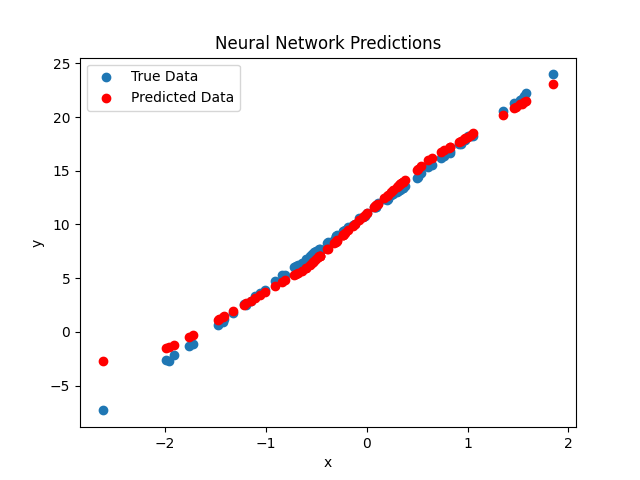

# Neural Network From Scratch (Using NumPy)

This project is an implementation of a neural network designed to approximate a linear function (y = 7x + 11) using **NumPy**. 
It demonstrates the fundamental mechanics of deep learning: forward propagation, ReLU activation and manual backpropagation.

## 🏗 Architecture
The network follows 1 -> 16 -> 1 architechture:
- Input Layer: A single feature (x)
- Hidden Layer: 16 neurons with ReLU activation
- Output Layer: A single output (y)

## 🧬 Mathematical Flow
The model learns by minimizing Mean Squared Error (MSE) via Gradient Descent.

**Forward Pass:**
1. $o_1 = X \cdot W_1 + b_1$
2. $f_{o1} = \text{ReLU}(o_1)$
3. $o_2 = f_{o1} \cdot W_2 + b_2$

**Backward Pass:**
To update the weights, the gradients are calculated by working backward from the error:
Output Gradient: $\frac{\partial L}{\partial \hat{y}} = \frac{2}{n}(\hat{y} - y)$
Hidden Layer Gradient: The derivative of ReLU: $f'(x) = 1$ if $x > 0$ else $0$.

## 📊 Predictions

The model learns to ignore the noise injected and learns the underlying trend of the function.
